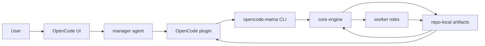
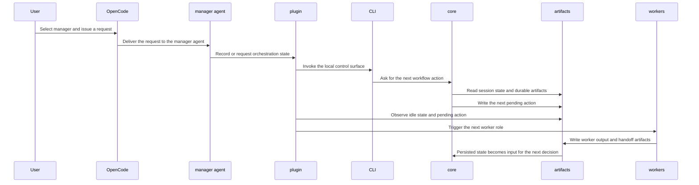

# Architecture

`opencode-mama` is a manager-led orchestration system for OpenCode projects. The design separates three concerns:

- `core` owns orchestration logic and workflow state transitions.
- `installer` owns the CLI and project bootstrap flow.
- the OpenCode plugin owns integration with the OpenCode runtime.

The system keeps repository-local artifacts as the durable source of truth. OpenCode events and CLI calls are integration surfaces, not the authoritative workflow record.

## Goals

- Keep the manager as the only control plane between the user and worker roles.
- Make workflow state explicit, resumable, and file-backed.
- Keep integration code thin so OpenCode-specific behavior does not leak into orchestration logic.
- Allow the same core engine to be driven from the plugin, the CLI, or future automation surfaces.
- Avoid using custom slash commands as orchestration control flow.

## System Overview

## Responsibilities

### core

`core` is the decision engine. It should own:

- workflow state normalization
- role routing
- pending action construction
- validation of manager-owned transitions
- reading and writing durable workflow artifacts

`core` should not know how OpenCode renders agents or how the installer scaffolds files.

### installer

`installer` is the bootstrap and shell entrypoint. It should own:

- the `opencode-mama` CLI
- project installation and removal
- copying the template surface into a target project
- prompting for conflicts during install

`installer` should stay thin and delegate orchestration decisions to `core`.

### plugin

The OpenCode plugin should own:

- binding the manager session to local workflow state
- observing OpenCode lifecycle events
- triggering the CLI or core engine when the manager becomes idle
- applying the next pending action from durable state

The plugin should not contain orchestration policy.

## Runtime Flow

## State Model

The canonical workflow state lives in repo-local artifacts.

- The active manager session is a tiny pointer.
- The active workflow record is the authoritative session state.
- Worker handoffs and queue messages are append-only coordination artifacts.
- OpenCode runtime state can be observed, but it is not the source of truth.

This gives the system three useful properties:

- workflows can resume without reconstructing conversational context
- worker outputs can be validated before they become authoritative
- the control plane can recover after process restarts or UI changes

## Boundaries

The architecture intentionally avoids these couplings:

- the manager should not depend on OpenCode prompt shortcuts as control flow
- custom slash commands should not be treated as a reliable manager API
- the plugin should not embed routing policy
- the installer should not own workflow semantics
- workers should not coordinate directly with one another

If a new feature does not fit one of those boundaries, it probably belongs in `core`.

## Extensibility

The split is designed to support future additions without collapsing the architecture:

- alternate UIs can talk to `core` through a different bridge
- new worker roles can be added without changing the plugin contract
- additional validation or scheduling logic can live in `core`
- bootstrap templates can evolve independently of runtime orchestration

## Open Questions

- Which exact state transitions should `core` own versus defer to the manager agent?
- How much of the current plugin template should be runtime code versus generated scaffold?
- Should the CLI expose read-only inspection commands in addition to bootstrap and execution?
